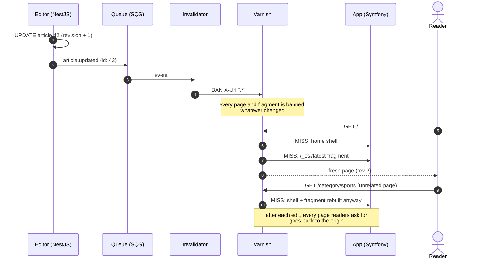
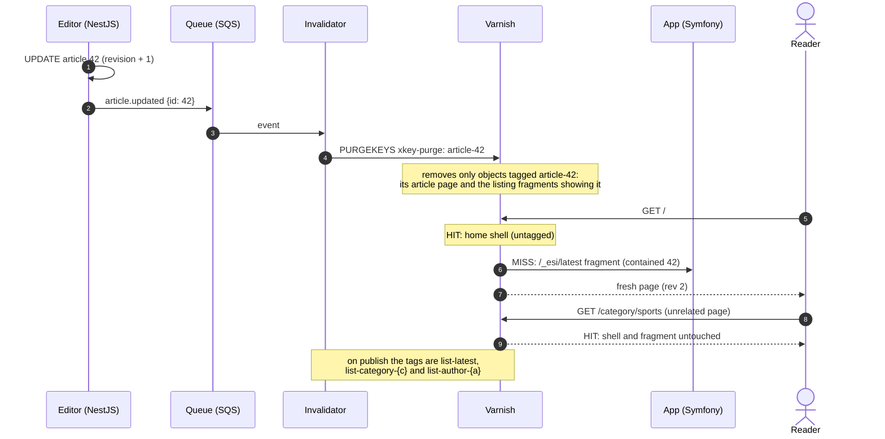
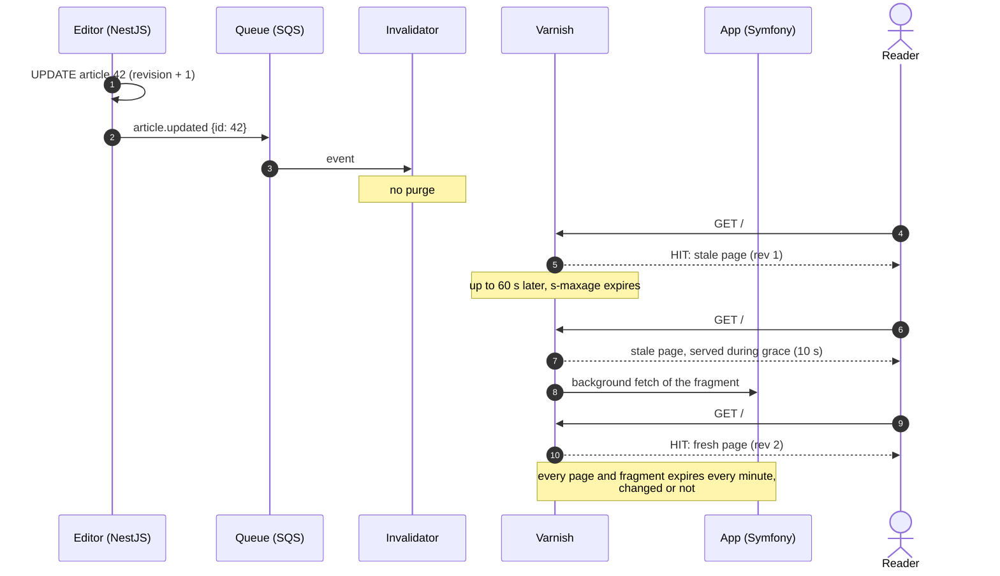
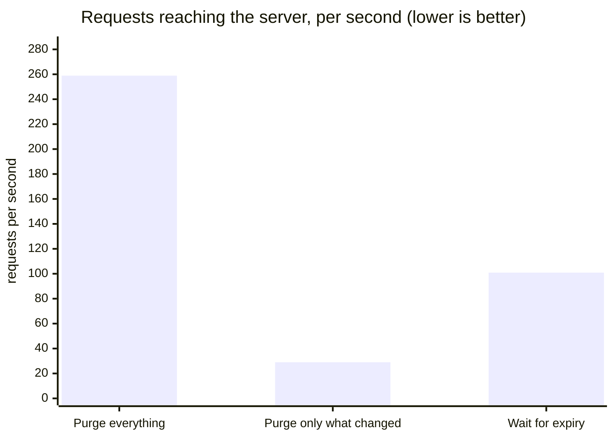
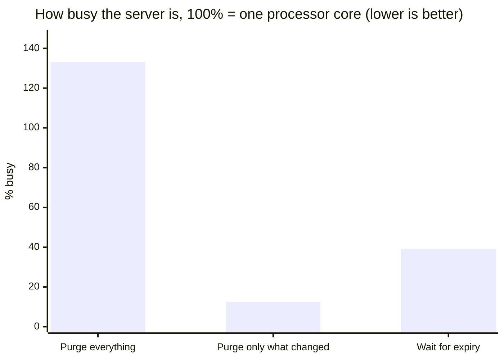
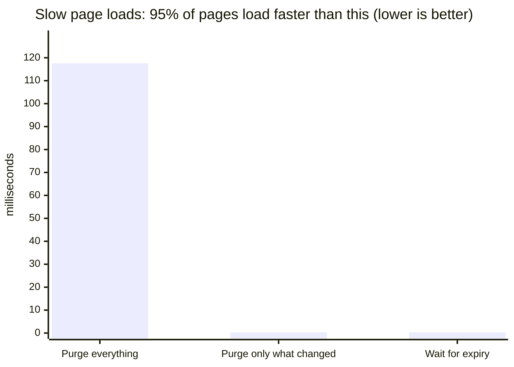
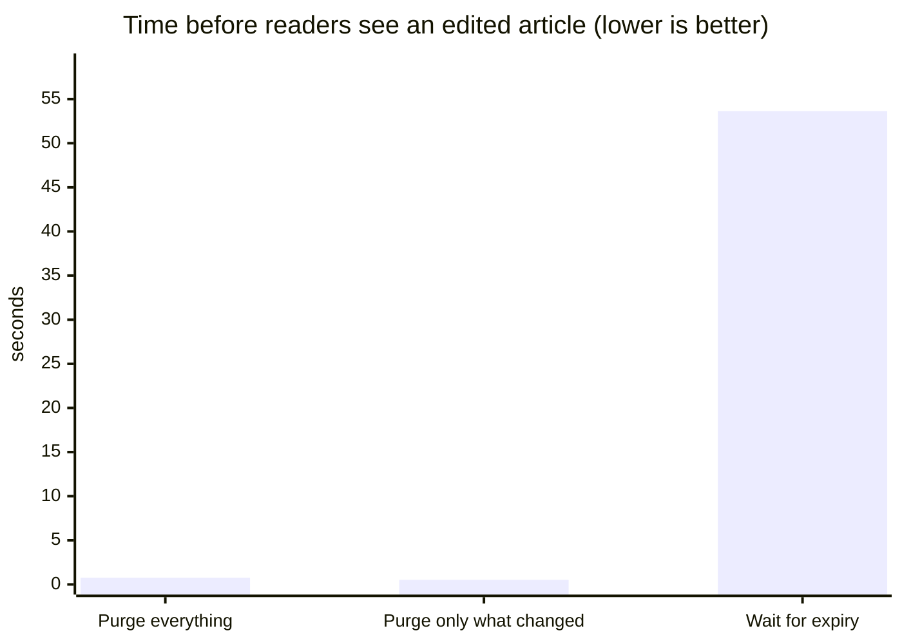
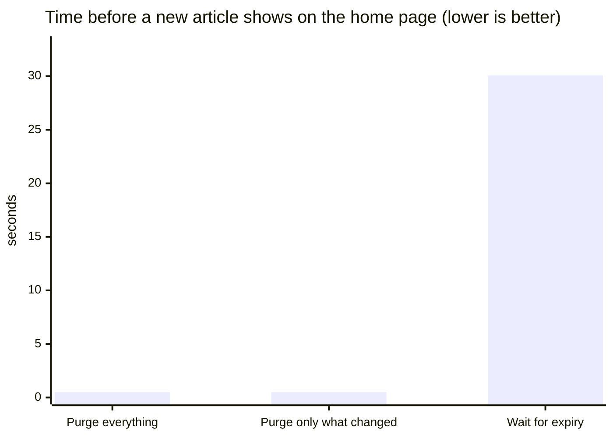

# invalidate-less

A reproducible benchmark comparing **full cache purges** with **tag-based cache invalidation** on a content-heavy website, using Symfony, Varnish, a NestJS editor service and a queue-driven invalidator (SQS API, Lambda-ready).

> Status: ✅ benchmarks done, see [Results](#results).

## The question

When content changes on a busy content site, how much origin load, latency and cache efficiency does tag-based invalidation save compared with purging everything?

## The scenario

A fake news site, seeded with fixtures:

- about 5,000 articles, 20 categories and 100 authors
- page types: home, category, author and article pages
- each page displays several pieces of content (the home page shows the latest articles, a category page lists its articles, and so on), so one article change affects several pages
- every article listing is an automatic list (latest articles by query), rendered as an ESI fragment that Varnish caches and tags separately from the page around it

During each benchmark run:

- simulated readers browse the site continuously
- an "editor" updates one article at a regular interval (for example, every 10 seconds), and publishes new articles that enter the automatic listings

## Strategies compared

| Strategy | On article update |
|---|---|
| **TTL only** (baseline) | Purge nothing; pages and listings expire after a short TTL (60 s) |
| **A. Full purge** | Ban the entire Varnish cache |
| **B. Tag-based purge** | Purge only what is tagged with the change (Varnish xkey): the article and listing fragments showing it on update, the listings it enters on publish |

A and B keep long TTLs (1 hour for articles, 1 day elsewhere) because purges keep content fresh. TTL only trades freshness for simplicity: readers can see content up to 60 s old, plus Varnish's 10 s default grace. The benchmark measures this staleness (see "visible after" below).

## Metrics

- origin requests per second
- cache hit ratio (from `varnishstat`)
- response time, p50 and p95 (from k6)
- origin CPU usage

## Stack

- PHP 8.3, Symfony 7, FOSHttpCacheBundle: the public site, read-only, tags its responses
- Node 24, NestJS 11: the editor service, writes articles and queues an event per change (like a CMS backoffice beside its front)
- An SQS queue (ElasticMQ locally, SQS-compatible) carrying CloudEvents, and an invalidator in TypeScript that consumes them and purges Varnish; it runs as a container worker locally and ships an AWS Lambda handler for the same code
- Varnish 7 with the xkey module
- SQLite (kept simple on purpose), shared by the site and the editor through a Docker volume
- Docker Compose for local runs
- k6 for load testing

## Architecture

```
readers ──> Varnish ──> app (Symfony, read-only: pages, ESI listings, cache tags)
                                      │ SQLite (shared volume)
editor (NestJS) ──writes──────────────┘
   └──SendMessage──> queue "article-events" ──> invalidator (worker | Lambda) ──BAN / PURGEKEYS──> Varnish
                          └── after 5 failed attempts ──> "article-events-dlq"
```

Invalidation is asynchronous: the editor answers once the event is queued, and the "visible after" metrics include the queue and the invalidator.

### Running the invalidator on another platform

The invalidator's core (`invalidator/src/core/`) maps an article event to a purge and knows nothing about where it runs. Only the entry adapters differ:

- **Any container platform** (ECS, Kubernetes, Fly, a VM): run the `invalidator/` image (the SQS worker). Set `QUEUE_URL`, `AWS_REGION` and credentials, and leave `SQS_ENDPOINT` unset to use real SQS.
- **AWS Lambda**: `npm run bundle:lambda` builds `dist/lambda/index.js` (handler `index.handler`, Node 24). Add an SQS event source mapping with `ReportBatchItemFailures`, so only failed messages are retried. Varnish must be reachable from the Lambda (same VPC) and must allow the Lambda's addresses in its `invalidators` ACL.
- **Another broker** (RabbitMQ, Pub/Sub…): events are plain CloudEvents JSON, so add an `ArticleEvents` adapter in the editor (`editor/src/events/`) and an entry adapter that calls `handleEvent` in the invalidator.

## How each strategy works

Every editor action starts the same way: the editor writes to SQLite (an update bumps the article's `revision`), queues a CloudEvent (`article.updated` or `article.published`) and answers right away. The invalidator then receives the event, and only what it does next differs. The diagrams follow an update of article 42, which is listed on the home page.

### A. Full purge



### B. Tag-based purge



### TTL only (baseline)



### In short

| Strategy | Purged per edit | Re-rendered by the origin afterwards | Change visible after |
|---|---|---|---|
| A. Full purge | the whole cache | every page and fragment readers ask for | as soon as the invalidator runs |
| B. Tag-based | only objects tagged with the change | the article page and the fragments showing it | as soon as the invalidator runs |
| TTL only | nothing | every page and fragment, once a minute | up to 60 s + 10 s grace |

## Getting started

Requirements: Docker with Docker Compose, `make`, and `curl` + `jq` for the benchmark runner (both ship with macOS).

```bash
docker compose up -d    # or: make start
```

On its first start the app installs the PHP dependencies and seeds the content (same data on every run), so the site needs a minute before it answers. `make seed` resets the content later on.

Then open:

- http://localhost:8002: Symfony directly (the origin, never cached)
- http://localhost:3002: the editor service (NestJS), which updates and publishes articles
- http://localhost:9335: the ElasticMQ UI (queue contents); the SQS API is on port 9334
- http://localhost:8082: the same site through Varnish

Check that caching works:

```bash
make check-cache
```

The first request shows `X-Cache: MISS`, the next ones `X-Cache: HIT` (pages stay cached for 1 hour for articles and 1 day for the other pages, unless invalidated).

Update an article and watch the cache get purged. Pick the strategy first:

- `full` (default): strategy A, bans the whole Varnish cache
- `tags`: strategy B, purges only the pages showing that article (Varnish xkey)
- `ttl`: no purge; the change shows up once the 60 s TTL expires

```bash
make strategy-tags   # or make strategy-full / make strategy-ttl; make strategy shows the active one

make update-article id=1
# or, as the k6 editor does:
curl -X POST http://localhost:3002/articles/1

make check-cache    # MISS again, then HIT (article 1 is on the home page)
make varnish-stats  # hits, misses, bans
```

### Make commands

Run `make` to list them all.

| Command | Description |
|---|---|
| `make install` | Install PHP dependencies (also done on the app's first start) |
| `make up` | Build and start app + Varnish in the foreground |
| `make start` | Build and start app + Varnish in the background |
| `make down` | Stop and remove containers |
| `make restart` | Restart containers in the background |
| `make logs` | Follow container logs |
| `make shell` | Open a shell in the app container |
| `make console c="cache:clear"` | Run a Symfony console command |
| `make composer c="require foo/bar"` | Run a Composer command |
| `make check-cache` | Show cache headers from Varnish |
| `make seed` | Recreate the schema and seed deterministic content |
| `make update-article id=42` | Update one article through the editor; the invalidator purges the cache |
| `make editor-build` | Rebuild and restart the editor after a code change |
| `make editor-logs` | Follow the editor's logs |
| `make invalidator-build` | Rebuild and restart the invalidator after a code change |
| `make invalidator-logs` | Follow the invalidator's logs (one line per handled event) |
| `make queue-stats` | Messages waiting and in flight, in the queue and its DLQ |
| `make publish-article` | Publish a new article (optional `category=3 author=7`); the invalidator purges the listings it enters |
| `make varnish-stats` | Show Varnish hit, miss, ban and object counters |
| `make strategy-full` | Switch to strategy A (full purge) |
| `make strategy-tags` | Switch to strategy B (tag-based purge) |
| `make strategy-ttl` | Switch to TTL only (no purge, short TTL) |
| `make strategy` | Show the active invalidation strategy |
| `make bench strategy=tags` | Run one benchmark for a strategy |
| `make bench-all` | Run the benchmark for every strategy |
| `make report` | Rebuild the README results section (medians, table, charts) from `bench/results/results.md` |

### Running a benchmark

```bash
make bench-all                                  # full, tags, then ttl, default settings
make bench strategy=tags                        # one strategy
RATE=2000 DURATION=5m make bench-all            # tuned
```

Each run is isolated and reproducible: it recreates the containers on the chosen strategy, reseeds the same data, empties Varnish, warms the cache with readers only, then measures. Readers send a fixed number of requests per second (open model), whatever the response times, so every strategy serves the same load. k6 runs in Docker (`grafana/k6`), so nothing else needs installing.

| Setting (env) | Default | Meaning |
|---|---|---|
| `RATE` | 1000 | reader requests per second through Varnish |
| `DURATION` | 3m | measured run length |
| `WARMUP_DURATION` | 30s | readers-only warm-up before measuring |
| `EDIT_EVERY` | 10 | seconds between editor actions (sent to the editor service) |
| `PUBLISH_EVERY` | 6 | every Nth editor action publishes a new article; the others update one |
| `PROBE_TIMEOUT` | 120 | seconds a freshness probe waits for a change to show up before giving up |
| `SEED` | 42 | random seed for the readers' page sequence |
| `SHORT_TTL` | 60 | shared TTL in seconds for the `ttl` strategy |

Readers' page mix: 15% home, 20% category, 10% author, 55% article; 80% of article views (and of updates) target the 200 newest articles.

Results print at the end and are appended to `bench/results/results.md` (raw k6 summary JSON next to it):

- **Reader req/s, p50, p95**: k6, reader requests only. **Dropped** counts reader requests k6 could not start in time; if it is not 0, the target rate was too high for the machine
- **Update / publish visible p95**: after each editor action, the editor polls the page through Varnish every 0.5 s until the change shows (the article's own page for an update, the home page's latest list for a publish) and records the delay, measured from the editor's answer, so it includes the queue and the invalidator. The 0.5 s polling also rounds it up. This is the staleness readers experience; **probe timeouts** count changes not visible within `PROBE_TIMEOUT`
- **Origin req/s**: Varnish `MAIN.backend_req` delta over the readers' window (page shells, ESI fragments and background refreshes)
- **Hit ratio**: `cache_hit / (cache_hit + cache_miss)` delta, counting every ESI fragment lookup
- **Origin CPU**: average of `docker stats` samples for the app container (100% = one core)

## Project structure

```
├── bench/                  k6 scenario (scenario.js) and benchmark runner (run.sh)
├── config/                 Symfony configuration
├── docker/varnish/         Varnish configuration (VCL)
├── public/index.php        Symfony front controller
├── docker/elasticmq/       Local SQS queue and its dead-letter queue
├── editor/                 NestJS editor service: article update/publish, queues article events
├── invalidator/            Queue consumer that purges Varnish: core, SQS worker and Lambda adapters
├── src/Command/            Console commands (seed, benchmark URLs)
├── src/Content/            Deterministic fake text generator
├── src/Controller/         Page controllers (home, category, author, article)
├── src/Entity/             Doctrine entities (Article, Category, Author)
├── src/Cache/              Cache tags and TTLs
├── templates/              Twig templates
├── docker-compose.yml      app (Symfony on FrankenPHP), Varnish, editor, sqs (ElasticMQ), invalidator, k6 (bench profile)
├── Dockerfile              PHP image for the app
└── Makefile                Shortcuts for common commands
```

## Scope (frozen)

**In scope:** everything above.

**Out of scope, on purpose:**

- authentication and admin UI (content updates go through the editor service's HTTP endpoints)
- visual design beyond readable HTML
- Infrastructure as Code, CI/CD, Kubernetes
- monitoring dashboards (k6 output, `varnishstat` and `make queue-stats` are enough)
- deploying to a cloud provider: the Lambda adapter is built and tested locally, not deployed
- a third framework or language

**Scope rule:** any new idea goes into the "Later" list below. It does not get built before the definition of done is met.

### Scope changes

The scope was frozen in week 1, then deliberately changed. Each change is recorded here with its reason:

| Change | Why |
|---|---|
| Added the **TTL only** baseline | Shows what invalidation buys compared with the common "just use a short TTL" setup |
| Dropped **strategy C** (CloudFront tag-to-URL invalidation) | Too expensive to benchmark: $0.005 per invalidation path after 1,000 free per month, and one edit can fan out to about 260 article pages (see "Later") |
| Moved writes to a **NestJS editor service** | Splits writes from reads, like a CMS backoffice beside its public site; the Symfony app is read-only |
| Moved invalidation to a **queue-driven invalidator** (SQS API, worker and Lambda adapters) | Decouples invalidation from the editor, the way it is often done in production; it also makes the measured "visible after" include a realistic async delay |

## Milestones

| Week | Milestone |
|---|---|
| 1 | Scope frozen (this document), repo created, Symfony app runs in Docker |
| 2 | Content model, fixtures, all page types render |
| 3 | Varnish in front of the app with proper cache headers; strategy A works |
| 4 | Strategy B: pages tagged, xkey purges on article update |
| 5 | k6 scenario written; first local benchmark runs |
| 6 | Final benchmark runs, results table and charts in this README |

## Definition of done

Anyone can clone this repository, run `docker compose up`, run a single benchmark command, and reproduce the results table below.

## Results

<!-- results:start -->
Median of 3 runs per strategy (1000 req/s target, 10 CPUs given to Docker, k6, Varnish and the app on the same machine). Compare strategies with each other rather than reading absolute numbers; `make report` rebuilds this section from `bench/results/results.md`.

| Strategy | Reader req/s | Dropped | Origin req/s | Hit ratio | p50 (ms) | p95 (ms) | Origin CPU | Update visible p95 (s) | Publish visible p95 (s) | Probe timeouts |
|---|---|---|---|---|---|---|---|---|---|---|
| A. Full purge | 995.5 | 819 | 258.9 | 87.0% | 0.1 | 117.6 | 133.1% | 0.77 | 0.50 | 0 |
| B. Tag-based | 1000.0 | 0 | 29.0 | 98.5% | 0.1 | 0.3 | 12.6% | 0.52 | 0.50 | 0 |
| TTL only | 999.6 | 81 | 100.9 | 96.4% | 0.1 | 0.3 | 39.2% | 53.65 | 30.07 | 0 |

In the charts, **purge everything** is strategy A, **purge only what changed** is strategy B (tags) and **wait for expiry** is TTL only (pages refresh on their own after 60 s). Times are the value 95% of cases stay under, and every number is the median of 3 runs.











In the last two charts, both purge strategies show changes in under a second; their bars only look empty next to the 30 to 55 seconds of waiting for expiry. Times are checked every half second, so anything under a second counts as immediate.
<!-- results:end -->

### What it shows

- **Tag-based purging wins on every measure.** It sends about 9 times fewer requests to the origin than a full purge and about 3.5 times fewer than TTL only, with about 10 times less origin CPU than a full purge. Changes show up as fast as with a full purge.
- **A full purge keeps content just as fresh, but the origin pays for it.** Every edit empties the whole cache, so pages and listings get rebuilt all at once. Reader p95 climbs to about 120 ms, and the machine could not always keep up: a few hundred of the 180,000 reader requests per run (under 0.5%) could not be sent on time.
- **TTL only costs less than a full purge, but readers see old content.** An update takes up to about 54 s to show (p95), and a new article up to 30 s to enter the latest list, because every page waits for its 60 s TTL. Its 96% hit ratio hides the cost: it still sends 3.5 times more origin requests than tag-based purging, because every page expires every minute whether it changed or not.
- **The queue barely shows.** Invalidation now goes through the queue and the invalidator, yet both purge strategies still make changes visible within the probes' 0.5 s resolution.

## Later

_Ideas parked until the definition of done is met:_

- Deploy the invalidator on AWS (real SQS + Lambda, Varnish in a VPC) and compare its delay with the local worker.
- Strategy C: CloudFront in front of Varnish with tag-to-URL invalidation. Dropped because invalidations cost $0.005 per path after 1,000 free per month, and an edit can fan out to about 260 article pages through the "More in category" fragment.
